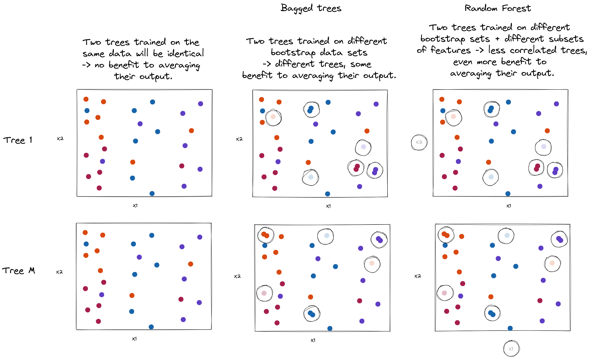

::: {.notes .handout-only .grad-only}

**Math prerequisites for this lecture**: You should know about:

* Variance of a random variable
* Independence of random variables
* Variance of sum of random variables

:::

\newpage

## Ensemble methods

### Recap: decision trees

* Let trees grow deep - low bias, high variance
* Don't let trees get deep: low variance, high bias

### Ensemble methods - the idea

Combine multiple **weak learners** - having either high bias or high variance - 
to create an **ensemble** with better prediction

### Ensemble methods - types (1)

* Combine multiple learners with high **variance** in a way that reduces their variance
* Combine multiple learners with high **bias** in a way that reduces their bias

### Ensemble methods - types (2)

* **Parallel**: build base estimators *independently* and then average their predictions. Combined estimator is usually better than any single base estimator because its *variance* is reduced.
* **Sequential**: (boosting) build base estimators *sequentially* and each one tries to reduce the *bias* of the combined estimator. 

## Bagging

### Bagging - background

* Designed for, and most often applied to, decision trees
* Name comes from **bootstrap aggregation** 

### Bootstrapping

* Basic idea: Sampling **with replacement**
* Each "bootstrap training set" is *same size* as full training set, and is created by sampling with replacement
* Some samples will appear more than once, some samples not at all

### Bootstrap aggregation

* Create multiple versions $1, \ldots, B$ of training set with bootstrap 
* Independently train a model on each bootstrap training set.
* For regression, average the predictions:

$$\hat{y}(x) = \frac{1}{B} \sum_{b=1}^B \hat{f}^b(x).$$

* For classification, use the majority vote as the final class:

$$\hat{y}(x)=\operatorname{mode}_{b=1,\ldots,B}\hat{y}^b(x).$$

### Bagging trees

* Construct $B$ trees using $B$ bootstrapped training sets
* Let the trees grow deep, no pruning
* Each individual tree has low bias, high variance
* Average regression predictions or vote on class predictions to reduce variance (if independent!)

### Variance reduction rule 

$$
\begin{aligned}
\mathrm{Var}(\bar X)
    &= \mathrm{Var}\!\left(\frac{1}{n}\sum_{i=1}^n X_i\right)
    && \text{Use the definition of the sample mean} \\[6pt]
    &= \frac{1}{n^2}\,\mathrm{Var}\!\left(\sum_{i=1}^n X_i\right)
    && \text{Use } \mathrm{Var}(aY) = a^2\,\mathrm{Var}(Y), \text{ with } a=\tfrac{1}{n} \\[6pt]
    &= \frac{1}{n^2}\left(\sum_{i=1}^n \mathrm{Var}(X_i) + 2\sum_{i<j}\mathrm{Cov}(X_i,X_j)\right)
    && \text{Use the variance of a sum (and symmetry of covariance)} \\[6pt]
    &= \frac{1}{n^2}\cdot n\,\mathrm{Var}(X_i)
    && \text{Use independence } (\mathrm{Cov}=0) \text{ and i.i.d. (equal variances)} \\[6pt]
    &= \frac{1}{n}\,\mathrm{Var}(X_i)
    && \text{Simplify}
\end{aligned}
$$

::: notes

The variance of a sum (third line) is:

$$\mathrm{Var}(\sum_i X_i)= \sum_i \mathrm{Var}(X_i)+  \sum_{i=1}^n\sum_{\substack{j=1\\ j\neq i}}^n \mathrm{Cov}(X_i,X_j) = \sum_i \mathrm{Var}(X_i)+2\sum_{i<j}\mathrm{Cov}(X_i,X_j)$$

:::

### Variance reduction rule (general)

For $n$ i.i.d.\ random variables, the variance of their mean decreases with $n$:

|              | **General RV** | 
|-------------|----------------|
| The average | $\bar{X} = \frac{1}{n}\sum_{i=1}^n X_i$ |
| Variance with independence | $\mathrm{Var}(\bar{X}) = \frac{1}{n}\mathrm{Var}(X_i)$ | 

### Variance reduction rule (bagged trees)

For $B$ **independent** bagged trees, variance decreases with $B$:

|             | **Bagged Trees** |
|-------------|----------------|
| The average | $\hat{f}_{bag}(x) = \frac{1}{B}\sum_{b=1}^B \hat{f}^b(x)$ |
| Variance with independence  | $\mathrm{Var}(\hat{f}_{bag}(x)) = \frac{1}{B}\mathrm{Var}(\hat{f}^b(x))$ |

...but, they are not really independent!

\newpage

### Correlated trees

Problem: trees produced by bagging are highly correlated, and:

$$
\mathrm{Var}(\bar{X}) = \frac{\sigma^2}{n}\left[1 + (n-1)\rho\right]
$$

where $\sigma^2 = \mathrm{Var}(X_i)$ (the same for all $i$) and $\rho = \mathrm{Corr}(X_i, X_j) 
= \frac{\mathrm{Cov}(X_i, X_j)}{\sqrt{\mathrm{Var}(X_i)\,\mathrm{Var}(X_j)}}$ is the correlation between each pair of $X_i, X_j$

::: notes

* Imagine there is one feature that is strong predictor, several moderate predictors
* Most/all trees will split on this feature
* Averaging correlated quantities does not reduce variance as much.

:::

### Random forests

Grow many decorrelated trees:

* **Bootstrap**: grow each tree with bootstrap resampled data set.
* **Split-variable randomization**: Force each split to consider _only_ a subset of $m$ of the $p$ predictors.

Typically $m = \frac{p}{3}$ for regression and $m = \sqrt{p}$ for classification, but this should be considered a tuning parameter.

### Bagged trees illustration

{ width=85% }

### A note on computation

* Bagged trees and random forests can be fitted in parallel on many cores!
* Each tree is built independently of the others

\newpage

## Boosting

### Boosting - training

**Iteratively** build a succession of models:

* Train a weak model. Typically a very shallow tree.
* In training set for $m$th model, focus on errors made by $(m-1)$th model.
* Use (weighted) model output
* Reduces bias _and_ variance!

### AdaBoost (Adaptive Boosting)

Adjust *weights* so that each successive model focuses on more "difficult" samples.

Consider a binary classification problem, where $y_i\in \{-1, +1\} \forall i$.

### AdaBoost algorithm

1. Let $w_i = \frac{1}{N}$ for all $i$ in training set.
2. For $m=1,\ldots,M$, repeat:

### AdaBoost algorithm (inner loop)

* Fit weak learner $\hat{f}^m$, on training data with sample weights $w_i$. 

* Compute weighted error $err_m$:

  $$err_m = \frac{\sum_{i=1}^N w_i \mathbf{1}[y_i \neq \hat{f}^m(x_i)]}{\sum_{i=1}^N w_i}$$

* Compute coefficient $\alpha_m = \log \left( \frac{1-err_m}{err_m} \right)$

* Update weights: $w_i \leftarrow w_i e^{\alpha_m \mathbf{1}[y_i \neq \hat{f}^m(x_i)]}$ (for misclassified samples, scale weight by $e^{\alpha_m}$)

### AdaBoost algorithm (final step)

3. Output final ensemble model:
   
   $$f_M(x) = \sum_{m=1}^{M} \alpha_m \hat{f}^{m}(x),  \quad  \hat{y}(x) = \operatorname{sign}[f_M(x)]$$

\newpage

### Gradient Boosting

* General goal of boosting: find the model at each stage that minimizes loss function on ensemble (computationally difficult!)

* AdaBoost interpretation (discovered years later): Gradient descent algorithm that minimizes exponential loss function.

* Gradient boosting: works for any differentiable loss function. At each stage, find the local gradient of loss function, and take steps in direction of steepest descent.

::: notes

Timeline:

* 1995-1997: Freund and Schapire introduce AdaBoost, as a boosting algorithm from learning theory (not framed in terms of a loss function).
* 1997-1999: Breiman observes that AdaBoost acts like an optimization procedure, Mason, Baxter, Bartlett and Frean show that boosting algorithms are gradient descent in function space.
* 1998-2000: Friedman, Hastie and Tibshirani show that AdaBoost minimizes the exponential loss ("Additive logistic regression: a statistical view of boosting").
* 1999-2001: Friedman generalizes this to any differentiable loss function: gradient boosting ("Greedy function approximation: a gradient boosting machine").

:::

### Gradient descent on parameters vs. functional gradient descent

We have seen gradient descent on model parameters:

$$
\begin{aligned}
w_j^{t+1} &= w_j^{t} - \alpha \left.\frac{\partial L(\mathbf{w})}{\partial w_j}\right|_{\mathbf{w}=\mathbf{w}^t}
    && \text{for each weight } j \\[6pt]
\end{aligned}
$$

now we introduce *functional* gradient descent for non-parametric models:

$$
\begin{aligned}
f_{m}(x_i) &= f_{m-1}(x_i) - \alpha \left.\frac{\partial L(y_i, f(x_i))}{\partial f(x_i)}\right|_{f=f_{m-1}}
    && \text{for each training sample } i
\end{aligned}
$$

::: notes

**Gradient descent**: the "parameters" are the model weights $\mathbf{w}$, and we want to minimize the loss $L(\mathbf{w})$.

**Functional gradient descent**: the "parameters" are the outputs of the ensemble at the $N$ training samples, $f(x_1), \ldots, f(x_N)$, and we want to choose the functions to minimize the total loss $\sum_{i=1}^N L(y_i, f(x_i))$. This is gradient descent over *functions* ("functional gradient descent"): each "parameter" is the value of the function at a training sample.

Note: The loss depends on $f$ only through its values at the training samples, so the negative gradient gives us one number $r_i$ per training sample: how we would like to change the ensemble's output at that sample. If we just added $r_i$ to $f(x_i)$ at each training sample, we would only get new values at the training samples, not a function that we can use to predict for a new $x$. (This is different from gradient descent on parameters, where changing $\mathbf{w}$ changes the model's predictions everywhere.) Instead, we will fit a tree to the pairs $(x_i, r_i)$: it approximates the negative gradient at the training samples, and gives us a function that we can evaluate at any $x$.

In both cases, we update each parameter with a step along the negative gradient.

:::

\newpage

### Gradient boosting - additive model

We have a differentiable loss function $L(y, f(x))$ and an additive model:

$$f_M(x) = \sum_{m=1}^{M} \alpha_m \hat{f}^m(x),$$

where each weak learner $\hat{f}^m(x)$ acts like a basis function.

Each iteration performs an update:

$$f_m(x) = f_{m-1}(x) + \alpha_m \hat{f}^m(x).$$

where at each step:

* $\hat{f}^m(x)$ - the weak learner - is chosen so that its predictions at the training samples point in the same direction as the negative gradient (so that a small step along it decreases the loss),
* $\alpha_m$ - the coefficient - determines the step size in that direction.

### (Optional) Adaboost as gradient boosting - exponential loss

In AdaBoost, we minimize the exponential loss function:

$$L(f) = \sum_{i=1}^N e^{-y_i f(x_i)/2}$$

::: notes

The $\frac{1}{2}$ in the exponent makes the loss-minimizing step $\alpha_m = \log\left(\frac{1-err_m}{err_m}\right)$, matching our earlier AdaBoost algorithm and `sklearn`. Without it, we'd have $\alpha_m = \frac{1}{2}\log\left(\frac{1-err_m}{err_m}\right)$, but the class predictions and relative sample weights would still be the same.

:::

### (Optional) Adaboost as gradient boosting - derivative of loss

::: notes

We evaluate the gradient at the current ensemble, $f = f_{m-1}$.

$$
\begin{aligned}
\frac{\partial L}{\partial f(x_i)}
    &= \frac{\partial}{\partial f(x_i)} \sum_{j=1}^N e^{-y_j f(x_j)/2}
    && \text{Definition of the loss} \\[6pt]
    &= \frac{\partial}{\partial f(x_i)} e^{-y_i f(x_i)/2}
    && \text{Only the term } j = i \text{ depends on } f(x_i) \\[6pt]
    &= -\tfrac{1}{2} y_i \, e^{-y_i f(x_i)/2}
    && \text{Chain rule: } \tfrac{d}{du} e^u = e^u, \text{ with } u = -y_i f(x_i)/2
\end{aligned}
$$

where $f_{m-1}(x) = \sum_{k=1}^{m-1} \alpha_k \hat{f}^k(x)$ is the AdaBoost ensemble output after round $m-1$.

We differentiate with respect to the model output $f(x_i)$ at each training sample, treating $x_i$ as fixed. This tells us how changing each prediction would change the loss.

:::

### (Optional) Adaboost as gradient boosting - negative gradient

The derivative of the loss with respect to the model output is:

$$\frac{\partial L}{\partial f(x_i)} = -\tfrac{1}{2} y_i e^{-y_i f_{m-1}(x_i)/2}$$

Therefore, the negative gradient is

$$r_i = \tfrac{1}{2} y_i e^{-y_i f_{m-1}(x_i)/2}$$

::: notes

The negative gradient, $r_i$, is the same expression with the sign flipped.

:::

### (Optional) Adaboost as gradient boosting - sample weights

This negative gradient can be written as

$$r_i = \tfrac{1}{2}\, y_i\, w_i, \quad \text{where } w_i = e^{-y_i f_{m-1}(x_i)/2}$$

* *sign* is $y_i$: it points toward the correct label. 
* *magnitude* is proportional to $w_i$: large for the samples that the current ensemble gets wrong, small for the samples that it already classifies correctly with confidence.

AdaBoost's sample weights are proportional to the negative gradient's magnitude.

### (Optional) Adaboost as gradient boosting - where the weights come from

Recall $w_i = e^{-y_i f_{m-1}(x_i)/2}$. After adding the next learner, the new weight is:

$$
\begin{aligned}
e^{-y_i f_m(x_i)/2}
    &= e^{-y_i f_{m-1}(x_i)/2} \, e^{-\alpha_m y_i \hat{f}^m(x_i)/2}
    && \text{Use } f_m = f_{m-1} + \alpha_m \hat{f}^m \\[6pt]
    &= e^{-y_i f_{m-1}(x_i)/2} \, e^{-\alpha_m/2} \, e^{\alpha_m \mathbf{1}[y_i \neq \hat{f}^m(x_i)]}
    && \text{Use } y_i \hat{f}^m(x_i) = \pm 1
\end{aligned}
$$

In each round, the weight is multiplied by:

* $e^{\alpha_m \mathbf{1}[y_i \neq \hat{f}^m(x_i)]}$: the AdaBoost weight update (for misclassified samples, scale the weight by $e^{\alpha_m}$)
* $e^{-\alpha_m/2}$: same for every sample, so it cancels when computing weighted error

These match the AdaBoost sample weights up to a common scale factor.

::: notes

* Correct prediction: $y_i \hat{f}^m(x_i) = +1$, so multiply the weight by $e^{-\alpha_m/2}$.
* Wrong prediction: $y_i \hat{f}^m(x_i) = -1$, so multiply the weight by $e^{\alpha_m/2} = e^{-\alpha_m/2} \, e^{\alpha_m}$.
* Both share the factor $e^{-\alpha_m/2}$. Drop that common factor, and we have the AdaBoost update: multiply the misclassified samples' weights by $e^{\alpha_m}$ and leave the others alone.

:::

\newpage

### (Optional) Adaboost as gradient boosting - aligning output with negative gradient

* The negative gradient $r_i$ tells us which way to change the prediction at sample $i$.
* The weak learner outputs $-1$ or $+1$: we want it to have the same sign as $r_i$.
* Choose the learner with the largest *alignment*:

$$\sum_i r_i \hat{f}^m(x_i)$$

::: notes

* If $r_i > 0$, we want to increase the current prediction. If $r_i < 0$, we want to decrease it.
* Adding a learner with the same sign as $r_i$ moves the prediction in the direction we want.
* In the alignment sum, matching signs add a positive term; opposite signs add a negative term. Samples with larger $|r_i|$ contribute more.
* For the same small positive step, the learner with the largest sum gives the greatest first-order decrease in loss among the candidates.

:::

### (Optional) Adaboost as gradient boosting - alignment is weighted accuracy

* Each sample adds either $+\frac{1}{2} w_i$ or $-\frac{1}{2} w_i$ to this sum:

$$r_i \hat{f}^m(x_i) = \tfrac{1}{2} w_i \, y_i \hat{f}^m(x_i) = \begin{cases} +\tfrac{1}{2} w_i & \text{if } \hat{f}^m(x_i) = y_i \text{ (correct)} \\ -\tfrac{1}{2} w_i & \text{if } \hat{f}^m(x_i) \neq y_i \text{ (wrong)} \end{cases}$$

* Maximizing this sum is the same as minimizing the weighted error:

$$err_m = \frac{\sum_i w_i \mathbf{1}[y_i \neq \hat{f}^m(x_i)]}{\sum_i w_i}$$

::: notes

* A correct prediction earns $\frac{1}{2}w_i$; a wrong one costs $\frac{1}{2}w_i$.
* The weights are fixed for this round, so maximizing the sum means minimizing the total weight of mistakes. Dividing by $\sum_i w_i$ gives AdaBoost's weighted error.

:::

### (Optional) Adaboost as gradient boosting - deriving the step size

* Keep the chosen learner fixed and choose $\alpha_m$ to minimize the loss:

$$\alpha_m = \operatorname*{arg\,min}_{\alpha} \sum_i e^{-y_i(f_{m-1}(x_i) + \alpha \hat{f}^m(x_i))/2}$$

* The loss-minimizing step is:

$$\alpha_m = \log\left(\frac{1-err_m}{err_m}\right)$$

\newpage

::: notes

Once we have chosen the learner, we try a step of size $\alpha$: $f = f_{m-1} + \alpha \hat{f}^m$. To find the best step, we write the loss as a function of $\alpha$, using $w_i = e^{-y_i f_{m-1}(x_i)/2}$ and $W = \sum_i w_i$:

$$
\begin{aligned}
L(\alpha)
    &= \sum_i e^{-y_i \left(f_{m-1}(x_i) + \alpha \hat{f}^m(x_i)\right)/2}
    && \text{Loss with } f = f_{m-1} + \alpha \hat{f}^m \\[6pt]
    &= \sum_i w_i \, e^{-\alpha y_i \hat{f}^m(x_i)/2}
    && \text{Use } w_i = e^{-y_i f_{m-1}(x_i)/2} \\[6pt]
    &= e^{-\alpha/2} \sum_{i \text{ correct}} w_i + e^{\alpha/2} \sum_{i \text{ wrong}} w_i
    && \text{Use } y_i \hat{f}^m(x_i) = \pm 1 \\[6pt]
    &= e^{-\alpha/2} (1 - err_m) W + e^{\alpha/2} \, err_m W
    && \text{Use } err_m = \textstyle\sum_{i \text{ wrong}} w_i / W
\end{aligned}
$$

Differentiating with respect to $\alpha$ gives

$$\frac{dL}{d\alpha} = -\tfrac{1}{2} e^{-\alpha/2} (1 - err_m) W + \tfrac{1}{2} e^{\alpha/2} \, err_m W$$

We set the derivative to zero and solve for $\alpha$:

$$
\begin{aligned}
\tfrac{1}{2} e^{\alpha/2} \, err_m W &= \tfrac{1}{2} e^{-\alpha/2} (1 - err_m) W
    && \text{Set } \tfrac{dL}{d\alpha} = 0 \text{ and rearrange} \\[6pt]
e^{\alpha} &= \frac{1 - err_m}{err_m}
    && \text{Multiply both sides by } 2 e^{\alpha/2} / (err_m W) \\[6pt]
\alpha &= \log\left(\frac{1 - err_m}{err_m}\right)
    && \text{Take the log}
\end{aligned}
$$

For $0 < err_m < 1$, the loss is convex in $\alpha$, so this step gives the minimum.

:::

### (Optional) Adaboost as gradient boosting - alignment and step size

* **Choose a direction:** pick the weak learner that maximizes alignment with the negative gradient:

$$\sum_i r_i\, \hat{f}^m(x_i)$$

* **Choose a step size:** minimize the loss along that learner's direction:

$$\alpha_m = \log\left(\frac{1-err_m}{err_m}\right)$$

* Minimizing weighted error maximizes alignment with the negative gradient.

\newpage

### Gradient boosting - general algorithm

1. Let $f_0(x) = 0$ for all $x$.
2. For $m=1,\ldots,M$, repeat:

### Gradient boosting - general algorithm (inner loop)

* Compute the *pseudo-residuals*, the negative gradient of the loss at the current ensemble output, for each $i$ in training set:

  $$r_{i,m} = - \left. \frac{\partial L(y_i, f(x_i))}{\partial f(x_i)} \right|_{f=f_{m-1}}$$

* Fit a tree $h^m$ with $d$ splits ($d+1$ leaf nodes) on training data $(X, r_m)$, where $r_m = (r_{1,m}, \ldots, r_{N,m})$ is the vector of pseudo-residuals for all training samples.

* Update $f$ with a *shrunken* version of the new tree, using learning rate $\nu$:

  $$f_m(x) = f_{m-1}(x) + \nu \, h^m(x)$$

::: notes

We fit each regression tree to the pseudo-residuals. For squared error loss, these are the ordinary residuals $y_i - f_{m-1}(x_i)$. For other losses, we compute them from the negative gradient instead.

We multiply each new tree's output by a learning rate $\nu < 1$, so we only add a fraction of its prediction to the ensemble. With a smaller $\nu$, we usually need more trees ($M$).

:::

### Gradient boosting - general algorithm (final step)

3. Output the boosted model:

   $$f_M(x) = \sum_{m=1}^M \nu \, h^m(x)$$

### Gradient boosting for classification

For binary classification with $y \in \{-1, +1\}$, we can use logistic loss.

The pseudo-residuals are numbers, so we fit *regression* trees to them. Each tree adds to or subtracts from the ensemble output $f_M(x)$.

With logistic loss, we get the predicted probability from $f_M(x)$:

$$\hat{P}(y=+1 \mid x) = \frac{1}{1 + e^{-f_M(x)}}.$$

We predict $+1$ when $f_M(x) > 0$ (probability above $0.5$), and $-1$ when $f_M(x) < 0$.

::: notes

Using $L(y,f) = \log(1 + e^{-yf})$, we get pseudo-residuals $r_{i,m} = y_i / (1 + e^{y_i f_{m-1}(x_i)})$. We fit each tree to these values, rather than to the class labels.

:::

### Gradient boosting - tuning

Tuning parameters to select by CV:

* Number of trees $M$
* Shrinkage parameter $\nu$, controls *learning rate*
* $d$, number of splits in each tree. ( $d=1 \rightarrow$ tree is called a *stump* )

## Summary of (selected) ensemble methods

* Can use a single estimator that has poor performance
* Combining the output of multiple estimators into a single prediction: better predictive accuracy, less interpretability
* Also more expensive to fit
